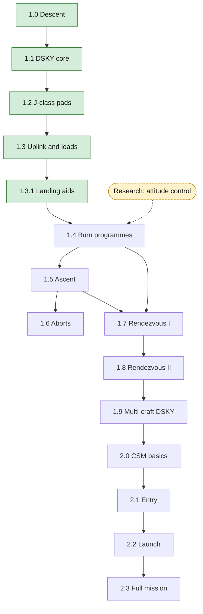

# Roadmap

Where the project is going. 1.0, 1.1, 1.2, 1.3 and 1.3.1 are released; everything else is planned and may change.

Status: ✅ released · 🚧 in progress · 🔬 researched · 📝 planned

## Phase 1: the lunar module (1.x)

| Version | Theme | What it adds | Status |
|---|---|---|---|
| **1.0** | Descent | Navigation, landing-site planner, P63 to P66, DSKY | ✅ |
| **1.1** | DSKY core | The DSKY becomes a core that runs programmes through a common interface; P63 to P66 become the first programmes. A software-version setting is added. No change to what the pilot sees. Started with `RUN dsky.`; the planner is run first. | ✅ |
| **1.2** | J-class pads | Luminary 210 pad loads (Apollo 15 to 17), the logic changes in 210's P63 to P66 (no P65), DSKY digits drawn as pictures (no font to install) | ✅ |
| **1.3** | Uplink and loads | The way data really reached the AGC: the update program (P27, V71/V72 uplink), the keyed load verbs (V21 to V25), and a planner that prints a PAD of what Mission Control would uplink (the landing site, the landing time and the DOI burn) and sends it to the DSKY as a simulated uplink; a box skips the uplink. Real Luminary addresses and scaling. | ✅ |
| **1.3.1** | Landing aids | Program alarms and an alarm facility in the DSKY core, flashing requests with KEY REL, the landing radar nouns and verbs, the flashing displays Luminary has in the descent (including the J-class ones), P66 back to P65, P68 landing confirmation. A fuel display and a MASTER ALARM lamp are not planned | ✅ |
| **1.4** | Burn programmes | P30 and P40 to P47 general burns, external delta-V, RCS burns; the AGC then flies the burns itself, starting with the DOI, and the KSP maneuver nodes are retired (a plane-change burn is the command module's, so it waits for 2.0). Includes the attitude control below if the research works | 📝 |
| **1.5** | Ascent | Ascent guidance, P12 liftoff from the surface | 📝 |
| **1.6** | Aborts | P70 and P71, abort stage, abort triggers during descent | 📝 |
| **1.7** | Rendezvous I | Target handling, conic solvers, CSI and CDH | 📝 |
| **1.8** | Rendezvous II | TPI, TPM, terminal phase, docking hand-off | 📝 |
| **1.9** | Multi-craft DSKY | A DSKY on each craft (the LM, later the command module), each running its own computer's profile: lamps, programme list, verb/noun tables, name, version | 📝 |

## Phase 2: the full mission (2.x)

Saturn launch, then the command module, the lunar module, the command module again for the trip home, and reentry.

| Version | Theme | What it adds | Status |
|---|---|---|---|
| **2.0** | CSM basics | Command module computer (Colossus and Artemis), SPS burns, mid-course corrections, lunar orbit insertion, transearth injection | 📝 |
| **2.1** | Entry | P61 to P67 entry guidance | 📝 |
| **2.2** | Launch | Saturn guidance and the TLI burn | 📝 |
| **2.3** | Full mission | Everything linked end to end | 📝 |

## Research track

Work that is being researched before it gets a place in a release. If it works it is included in the release named in the last column; if not, the current approach stays.

| Item | What it is | Status | Possible release |
|---|---|---|---|
| **Attitude control** | An autopilot like the Lunar Module's own (Luminary's digital autopilot, the DAP) instead of kOS's steering lock: the guidance-to-autopilot interface (commanded rates over the 2 s guidance pass, a lag angle, a thrust-direction filter), jet firing from a phase plane with the real deadbands, the descent engine's gimbal trim, and the pilot's stick handled as the real DAP does. It starts with a probe of the RCS on the Realism Overhaul LM (how short a pulse works, whether the engine gimbal shares the control inputs, how much each jet turns the ship) to find out whether this can work in kOS at all | 🔬 Being researched | 1.4, if it works |

## Order and dependencies

Green: released. Yellow, dashed: research, not yet a release. A dashed arrow means "joins".

1.3.1 (landing aids) comes before the burn programmes because it is small and still part of the landing, and its alarm facility is used by the burn programmes; it has no dependency on them (the alarm facility lives in the DSKY core). It is a patch release, so the next number is 1.4.

`RUN plan.` opens the deorbit planner only. When the second planner arrives (ascent, 1.5), it becomes one planner window with a menu fed by a table, like the DSKY's programme table, and the saved plan is split into one file per planner.

The 1.1 DSKY core is designed from one vehicle, the LM. Its data tables (nouns, verbs, lamps, programmes) and the fixed LM panel will need some rework at 1.9, when a second vehicle shows what really differs.

## Between releases

- Bug fixes ship as patch versions (1.0.1 and so on).
- DSKY interface improvements ship whenever they are ready, as a minor or patch version.
- Documentation and demo material.

## Not planned

- Alignment programmes (P51 to P53).
