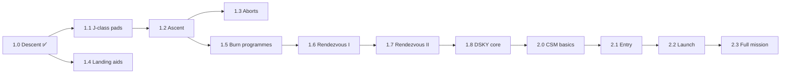

# Roadmap

Where the project is going. Only 1.0 is released; everything else is planned and may change.

Status: ✅ released · 🔬 researched · 📝 planned

## Phase 1: the lunar module (1.x)

| Version | Theme | What it adds | Status |
|---|---|---|---|
| **1.0** | Descent | Navigation, landing-site planner, P63 to P66, DSKY | ✅ |
| **1.1** | J-class pads | Luminary 210 pad loads (Apollo 15 to 17), the logic changes in 210's P63 to P66, testing with other landers | 🔬 |
| **1.2** | Ascent | Ascent guidance, P12 liftoff from the surface | 📝 |
| **1.3** | Aborts | P70 and P71, abort stage, abort triggers during descent | 📝 |
| **1.4** | Landing aids | Program alarms, landing radar state updates, fuel display, optional 1201/1202 training mode | 📝 |
| **1.5** | Burn programmes | P40 to P47 general burns, external delta-V, RCS burns | 📝 |
| **1.6** | Rendezvous I | Target handling, conic solvers, CSI and CDH | 📝 |
| **1.7** | Rendezvous II | TPI, TPM, terminal phase, docking hand-off | 📝 |
| **1.8** | DSKY core | A standalone DSKY with a profile per vehicle | 📝 |

## Phase 2: the full mission (2.x)

Saturn launch, then the command module, the lunar module, the command module again for the trip home, and reentry.

| Version | Theme | What it adds | Status |
|---|---|---|---|
| **2.0** | CSM basics | Command module computer (Colossus and Artemis), SPS burns, mid-course corrections, lunar orbit insertion, transearth injection | 📝 |
| **2.1** | Entry | P61 to P67 entry guidance | 📝 |
| **2.2** | Launch | Saturn guidance and the TLI burn | 📝 |
| **2.3** | Full mission | Everything linked end to end | 📝 |

## Order and dependencies

1.4 does not depend on the ascent work and can be done at any point after 1.0.

## Between releases

- Bug fixes ship as patch versions (1.0.1 and so on).
- DSKY interface improvements ship whenever they are ready, as a minor or patch version.
- Documentation and demo material.

## Not planned

- Alignment programmes (P51 to P53).
