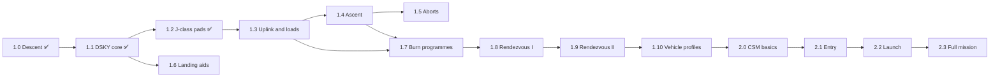

# Roadmap

Where the project is going. 1.0, 1.1 and 1.2 are released; everything else is planned and may change.

Status: ✅ released · 🚧 in progress · 🔬 researched · 📝 planned

## Phase 1: the lunar module (1.x)

| Version | Theme | What it adds | Status |
|---|---|---|---|
| **1.0** | Descent | Navigation, landing-site planner, P63 to P66, DSKY | ✅ |
| **1.1** | DSKY core | The DSKY becomes a core that runs programmes through a common interface; P63 to P66 become the first programmes. A software-version setting is added. No change to what the pilot sees. Started with `RUN dsky.`; the planner is run first. | ✅ |
| **1.2** | J-class pads | Luminary 210 pad loads (Apollo 15 to 17), the logic changes in 210's P63 to P66 (no P65), DSKY digits drawn as pictures (no font to install) | ✅ |
| **1.3** | Uplink and loads | The way data really reached the AGC: the update program (P27, V71/V72 uplink), the keyed load verbs (V21 to V25), and a manual planner mode that prints a PAD of what to uplink and what to key. Real Luminary addresses and scaling. | 🔬 |
| **1.4** | Ascent | Ascent guidance, P12 liftoff from the surface | 📝 |
| **1.5** | Aborts | P70 and P71, abort stage, abort triggers during descent | 📝 |
| **1.6** | Landing aids | Program alarms, landing radar state updates, fuel display, optional 1201/1202 training mode | 📝 |
| **1.7** | Burn programmes | P30 and P40 to P47 general burns, external delta-V, RCS burns; the AGC then flies the burns itself and the KSP maneuver nodes are retired | 📝 |
| **1.8** | Rendezvous I | Target handling, conic solvers, CSI and CDH | 📝 |
| **1.9** | Rendezvous II | TPI, TPM, terminal phase, docking hand-off | 📝 |
| **1.10** | Vehicle profiles | A standalone DSKY with a profile per vehicle (lamps, programme list, verb/noun tables, name, version) | 📝 |

## Phase 2: the full mission (2.x)

Saturn launch, then the command module, the lunar module, the command module again for the trip home, and reentry.

| Version | Theme | What it adds | Status |
|---|---|---|---|
| **2.0** | CSM basics | Command module computer (Colossus and Artemis), SPS burns, mid-course corrections, lunar orbit insertion, transearth injection | 📝 |
| **2.1** | Entry | P61 to P67 entry guidance | 📝 |
| **2.2** | Launch | Saturn guidance and the TLI burn | 📝 |
| **2.3** | Full mission | Everything linked end to end | 📝 |

## Order and dependencies

1.6 does not depend on the ascent work and can be done at any point after 1.1 (the alarm facility lives in the DSKY core).

`RUN plan.` opens the deorbit planner only. When the second planner arrives (ascent, 1.4), it becomes one planner window with a menu fed by a table, like the DSKY's programme table, and the saved plan is split into one file per planner.

The 1.1 DSKY core is designed from one vehicle, the LM. Its data tables (nouns, verbs, lamps, programmes) and the fixed LM panel will need some rework at 1.10, when a second vehicle shows what really differs.

## Between releases

- Bug fixes ship as patch versions (1.0.1 and so on).
- DSKY interface improvements ship whenever they are ready, as a minor or patch version.
- Documentation and demo material.

## Not planned

- Alignment programmes (P51 to P53).
