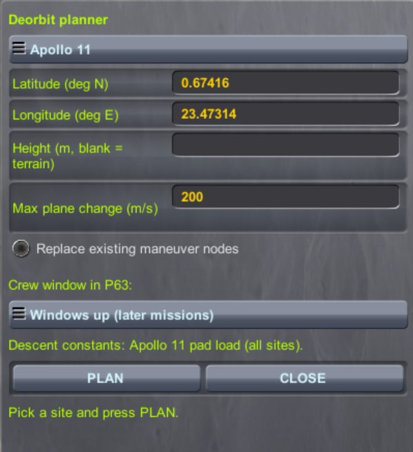
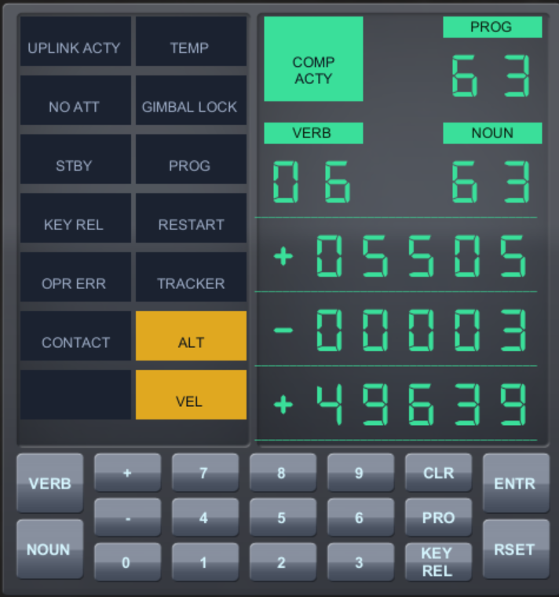

# LM Guidance Computer: Pilot's Manual

How to fly a powered descent and landing with the Apollo-inspired LM computer in KSP (kOS, Realism Overhaul, Sol).
For installation see the [README](../README.md).

Flown and confirmed: planning, P63 braking, P64 approach with redesignation (in `UP` window mode), P65 automatic landing, P66 rate of descent, touchdown. Not flown: `KEEP` window mode in P64.

## Contents

- [Flight at a glance](#flight-at-a-glance)
- [1. What you need](#1-what-you-need)
- [2. Starting up](#2-starting-up)
- [3. Planning the descent](#3-planning-the-descent)
- [4. The DSKY](#4-the-dsky)
- [5. The descent](#5-the-descent)
- [6. Messages](#6-messages)
- [7. Settings](#7-settings)
- [8. Differences from the real LM](#8-differences-from-the-real-lm)
- [9. If something goes wrong](#9-if-something-goes-wrong)

## Flight at a glance

The whole flight on one page. Details are in the sections that follow.

| # | Step | What you do |
|---|---|---|
| 1 | In orbit | Bound lunar orbit, no time warp. Type `RUN start.` |
| 2 | Plan | Pick a site, press **PLAN**, then **CLOSE**. The terminal says "plan OK" |
| 3 | Deorbit | Fly the plane-change node (if any) and the DOI node yourself. Warp to each |
| 4 | P63 | `V37 E 63 E` after the DOI burn. The ship turns and warps you to 60 s before ignition (PDI) by itself |
| 5 | Ignition | At 5 s before ignition `V99 N62` flashes: press **PRO** to enable the engine |
| 6 | P64 | Starts by itself after braking. Press **PRO** to permit redesignation, then the KSP keys **W/S** (0.5°) and **A/D** (2°) move the aim point |
| 7 | P65 | Starts by itself. It nulls the horizontal speed and lands at 3 ft/s |
| 8 | P66 (optional) | SAS on, then **Shift** (slower) or **Ctrl** (faster) to set the rate of descent yourself |
| 9 | Touchdown | CONTACT lamp lights, the engine cuts off, PROG 68. `V34 E` ends the computer |

`V34 E` ends any programme at any time and hands the controls back.

## 1. What you need

> **Not guaranteed.** This was developed and flown on one lander only (a Realism Overhaul LM, descent engine LMDE) in one setup: the Sol planet pack with Mirage and TiltEm, Realism Overhaul and kOS 1.6.0.1. It has not been tested on any other lander or setup, and it is not guaranteed to work at all. You fly it at your own risk.

- Mods used: Sol (replaces RSS), Mirage, TiltEm and Realism Overhaul. TiltEm tilts the spin axes, and the computer builds the Moon's spin from its north pole to allow for that.
- A lunar lander (the RO LM it was flown with: descent engine LMDE, RCS for ullage) in a bound lunar orbit above the PDI altitude, for example about 110 km circular.
- No time warp, and no maneuver nodes you want to keep (or tick "Replace existing maneuver nodes" in the planner).
- A kOS processor on the lander.

## 2. Starting up

In the kOS terminal:

```
RUN start.
```

The **planner window** opens (section 3). When you press CLOSE, one terminal line tells you whether the saved plan is OK, missing, past its PDI or stale, and the **DSKY window** opens. If you already have a good plan, just press CLOSE.

## 3. Planning the descent

In the planner window:



*The planner window: site menu, latitude and longitude, optional height, largest plane change, replace-nodes tick box, crew window choice, then PLAN and CLOSE. The line at the bottom shows the result after PLAN.*

1. Pick an Apollo landing site from the menu, or choose Custom and type a latitude and longitude (degrees; east is positive). Leave the height blank to use the terrain height.
2. Optional: set the largest plane-change burn you will accept (m/s, default 200), tick "Replace existing maneuver nodes", and choose the **crew window in P63**: "Windows up (later missions)" (`UP`: the ship turns so the window faces the site) or "Keep the roll (Apollo 11)" (`KEEP`: the roll is kept).
3. Press **PLAN**. The window shows a two-line result. The planner adds up to two maneuver nodes: a plane change (only if the site is more than 2 km out of your orbit plane) and the DOI burn that puts you on the descent orbit, with PDI (powered descent initiation) at the perilune.
4. If it fails it removes its own nodes and says why (no bound orbit, time warp on, terrain too low on the descent orbit, plane change too large...).
5. **CLOSE** leaves the nodes in place and starts the DSKY.

The descent constants are the Apollo 11 pad load for every site. A site with rough terrain under the descent orbit is refused rather than flown into.

**Fly the nodes yourself** (kOS does not steer them), warping to each as usual. After the DOI burn you are on the descent orbit. You do not need to coast or warp to PDI: start P63 straight away (section 5) and it warps you there.

## 4. The DSKY

A window shaped like the LM's DSKY: PROG, VERB, NOUN and three data registers R1, R2, R3, with lamps and a keypad.



*The DSKY in P63 braking: PROG 63, `V06 N63` (R1 speed along the burn in ft/s, R2 descent rate in ft/s, R3 height in ft). The amber ALT and VEL lamps are lit.*

**Lamps that work:**

| Lamp | Lit when |
|---|---|
| COMP ACTY | a displayed value is changing (the computer is working) |
| PROG | a programme alarm (1406, time-to-go not converged) |
| OPR ERR | a bad key entry or a refused programme. **RSET** clears it |
| KEY REL | the programme wants the display back (for example at the engine prompt) |
| ALT | the landing radar's altitude data is not good (above 12 km, or it fails the check) |
| VEL | the landing radar's velocity data is not good (above 2000 ft/s, or it fails the check) |
| CONTACT | the lander has touched down |

The other lamps (UPLINK ACTY, NO ATT, STBY, TEMP, GIMBAL LOCK, RESTART, TRACKER) are placeholders and never light.

### Working the DSKY

You work the DSKY by clicking the on-screen buttons. Single buttons are written in bold, like **PRO**. Verb and noun entries are written as shorthand in code style: `V37 E 63 E` means click VERB, 3, 7, ENTR, 6, 3, ENTR; `V16 N61 E` means VERB, 1, 6, NOUN, 6, 1, ENTR (V is VERB, N is NOUN, E is ENTR).

| Button | Does |
|---|---|
| **VERB**, **NOUN** + two digits | Enter a verb or noun |
| **ENTR** | Accept what you keyed |
| **PRO** | Proceed: enable the engine, allow redesignation |
| **CLR** | Clear the digits you are keying |
| **RSET** | Clear the OPR ERR lamp |
| **KEY REL**, **+**, **-** | Do nothing yet |

The keyboard also works, but only while the kOS terminal window has focus (click it first): V, N, digits, E (ENTR), P (PRO), C (CLR), R (RSET). Clicking the DSKY buttons needs no focus, so it is the way to do it.

Flying keys are different: **W/S/A/D**, **Q/E**, **Shift** and **Ctrl** are KSP's own flight keys, read while the KSP window has focus.

#### How verbs and nouns work

The VERB and NOUN cells say two things:

- The **verb** is what you want done: show something, or change the programme.
- The **noun** is which data the three registers R1, R2 and R3 show (speed, height, time...).

To change what the display shows, key a verb and a noun and press ENTR: `V16 N61 E`. The display starts at `V16 N60`.

- While you key a verb or noun, the digits you type appear in its cells and the VERB/NOUN line flashes until you press **ENTR**.
- You can key only the noun (`N61 E`) and keep the verb, or only the verb and keep the noun.
- **CLR** drops the digits you are keying. Pressing **VERB** or **NOUN** again starts the entry over.
- A number the computer does not know, or digits keyed without pressing **VERB** or **NOUN** first, lights **OPR ERR** and changes nothing. Press **RSET** to clear it.
- Changing the programme takes two steps: `V37 E` makes the display wait for a programme number, then the two digits and **ENTR**: `V37 E 63 E`. Pressing **VERB** or **NOUN** instead cancels the wait.

During a programme you rarely key anything, because the programme sets the verb and noun at each step (see "What each programme displays by itself" below).

#### Verbs

| Verb | Does |
|---|---|
| `V06 N## E` | Display a noun's registers |
| `V16 N## E` | Monitor a noun: the registers keep updating |
| `V37 E 63 E` | Change programme: start P63. `V37 E 00 E` ends the running programme |
| `V34 E` | Terminate: ends the programme and the LM computer, and the controls go back to you |
| V99 | Shown by P63 itself, flashing, to ask you to enable the engine. You answer with **PRO**. You never key it |

On the real DSKY V06 shows a noun once and V16 keeps updating it. Here both update live, so either works. The programmes use V06, and the manual uses V16 when you key one yourself. Only P63 can be started (P00 ends it): P64, P65 and P66 start by themselves.

#### Nouns

Units are Apollo's: feet, ft/s, nautical miles. A register shows NA until its value exists (the P63 values do not exist before P63 starts).

| Noun | R1 | R2 | R3 |
|---|---|---|---|
| N60 | horizontal speed (ft/s) | descent rate (ft/s) | height above the site (ft) |
| N61 | time to ignition (`+MM SS`) | braking time to go (`MM SS`) | out-of-plane distance (nm) |
| N62 | speed along the burn (ft/s) | time to go (`MM SS`) | delta-v gained (ft/s) |
| N63 | speed along the burn (ft/s) | descent rate (ft/s) | height (ft) |
| N64 | look angle to the site (deg) | descent rate (ft/s) | height (ft) |
| N68 | range to the site (nm) | not used | height difference (ft) |

#### Useful ones

| Keys | Why |
|---|---|
| `V16 N60 E` | The general descent view: how fast you are moving sideways, how fast you are falling, how high. Before P63, a check of your height above the site |
| `V16 N68 E` | The range to the landing site. Before P63 it tells you how far you still are |
| `V16 N61 E` | During P63: time to ignition and the braking time to go |
| `V16 N64 E` | The look angle to the site, to judge a redesignation |
| `V37 E 63 E` | Start P63 |
| `V34 E` | End it all and take the controls back |

#### What each programme displays by itself

| When | VERB NOUN | R1 | R2 | R3 |
|---|---|---|---|---|
| P63 countdown (TIG-30 to TIG-5) | `V06 N62` | speed along the burn | time to ignition (`+MM SS`) | delta-v gained |
| P63 engine prompt (TIG-5, flashing) | `V99 N62` | same as above | same | same |
| P63 burning | `V06 N63` | speed along the burn (ft/s) | descent rate (ft/s) | height (ft) |
| P64 approach | `V06 N64` | look angle to the site (deg) | descent rate (ft/s) | height (ft) |
| P65 and P66 | `V06 N60` | horizontal speed (ft/s) | descent rate (ft/s) | height (ft) |

You can key a different noun at any time during a programme and the programme carries on. The programme only sets the display when its state changes (the countdown, the engine prompt, the engine lighting, the hand-over to the next programme), so a noun you key stays until the next change.

## 5. The descent

The programmes follow each other: P63 → P64 → P65, and P66 if you take over the rate of descent.

### Before P63

After the DOI burn, with the DSKY open, start with `V37 E 63 E`. You do not coast or warp to PDI yourself: P63 does it.

### P63: braking

The lander turns to the burn attitude, then warps all the way to 60 s before ignition (cancel the warp with KSP's own cancel key if you like; it does not restart). Then:

- The display is blank until 35 s before ignition, then counts down from 30 s.
- RCS ullage fires at about 7.5 s before ignition.
- At 5 s before ignition the display shows `V99 N62` flashing and the terminal says "PLEASE ENABLE ENGINE: PRESS PRO". Press **PRO** to enable the engine.
- The engine lights at ignition and goes to full throttle 26 s later.

The SAS button is the AUTO / ATT HOLD switch: SAS on holds attitude, SAS off lets P63 steer. `V16 N61 E` shows the braking time to go in R2. P63 hands over to P64 by itself when braking is almost over (time to go below 62 s).

### P64: approach and redesignation

PROG shows 64 and the display `V06 N64` flashing. R1 is the look angle to the site, R2 the descent rate (ft/s), R3 the height (ft). P64 steers and throttles to the approach targets and hands over to P65 by itself about 150 s later.

**Redesignation** (moving the aim point): press **PRO** once to permit it (the flashing stops). Then, with SAS off (AUTO only), use the KSP flight keys:

- Each tap of the pitch keys (W, S) moves the aim point 0.5°.
- Each tap of the yaw keys (A, D) moves it 2°.

A held key counts as one click. The terminal prints each redesignation and R1 changes. It closes about 34 s before the end of P64. The green "LM SITE" pin in map view follows the aim point.

### P65: automatic landing

PROG shows 65 and the display `V06 N60`: R1 horizontal speed, R2 descent rate, R3 height. P65 nulls the horizontal speed and settles to a descent of 3 ft/s (0.9 m/s), following the guidance direction. The ship keeps its roll (a roll key still rolls it in AUTO). You can let it land by itself.

### P66: you control the rate of descent

Switch SAS on (the ATT HOLD switch), then tap **Shift** (slower descent) or **Ctrl** (faster descent). Each tap is one rate-of-descent click of 1 ft/s, and the first one starts P66 (PROG 66). The terminal prints the new commanded rate. In P66 the throttle holds your commanded rate and you fly the attitude yourself with SAS on. A click in AUTO (SAS off) is ignored, as in Luminary.

### Touchdown

The CONTACT lamp lights when the lander touches down, the engine cuts off a quarter of a second later (you can stop it first) and PROG shows 68. The programme ends and the controls are yours.

`V34 E` ends any programme at any time and hands the controls back.

## 6. Messages

The terminal prints a short message at each step: "P63: ENGINE ON", "P64: REDESIGNATION PERMITTED...", "P66: COMMANDED DESCENT RATE...", "CONTACT...", "P68: LANDING CONFIRMED". Warnings and refusals are always shown.

**P63 refused** (OPR ERR lights; press **RSET** to clear it):

| Message | Cause | Fix |
|---|---|---|
| no saved deorbit plan | never planned, or the last plan failed | run the planner |
| saved plan is for another landing site | you started the computer with a different site | plan again |
| the planned PDI time has passed | you missed PDI | plan again |
| the orbit is not bound | not in orbit | get into orbit |
| no engine found | the computer found no engine on the ship | check staging |

**Alarm 1406 / PROG lamp:** the time-to-go calculation did not converge. The guidance keeps the last value and carries on.

## 7. Settings

The defaults are tuned for the RO LM. They are in `scripts/lm_constants.ks` (installed as `Ships/Script/lm/lm_constants.ks`). Edit and re-run.

| Setting | Default | Use |
|---|---|---|
| `LM_LOG` | FALSE | TRUE writes diagnostic logs to `0:/lm/` (`p63.log`, `p64.log`, `p65.log`, `lm_check.log`, `lm_deorbit.log`). Useful for bug reports |
| `P63_WINDOW_MODE` | `UP` | Default crew window mode (the planner window sets it too) |
| `P63_WARP_LEAD_S` | 60 | Seconds before ignition at which the warp stops |
| `P64_PITCH_SIGN`, `P64_YAW_SIGN` | 1, -1 | Flip if a redesignation key moves the aim point the wrong way |
| `P66_ROD_SIGN` | 1 | Flip if Shift/Ctrl change the rate the wrong way |
| `BODY_NAME` | `Moon` | The body you land on |

## 8. Differences from the real LM

- The computer is not an AGC emulation: it recreates what the crew saw and did, using KSP data. The guidance equations are ported from the Luminary 099 source (the Apollo 11 LM software).
- The cycle is 0.25 s, not Luminary's 2 s, for a smoother display.
- Touchdown cut-off is automatic. The crew stopped the engine by hand.
- The ignition and descent geometry is the Apollo 11 pad load for every site, and the planner fits your orbit to it.
- The planner replaces mission control: it finds the DOI burn and the PDI time for you.
- The RO LMDE gives more thrust than the throttle command at low settings. P65 and P66 compensate with the engine's measured throttle curve and a thrust trim.
- The landing radar is simulated from the terrain height kOS gives, so the ALT and VEL lamps follow Luminary's tests on that data. Only the lamps listed in section 4 are driven. The + / - and KEY REL keys do nothing. V37, V34, V06, V16 and V99 are the only verbs.
- `KEEP` window mode in P64 is assumed, not flown.

## 9. If something goes wrong

- **A key moves the wrong way:** see the sign settings in section 7.
- **P63 refuses to start:** see the table in section 6.
- **Anything else:** `V34 E` ends the LM computer and gives you the controls. To report a bug, set `LM_LOG` to TRUE, fly again and send the logs from `0:/lm/`.
