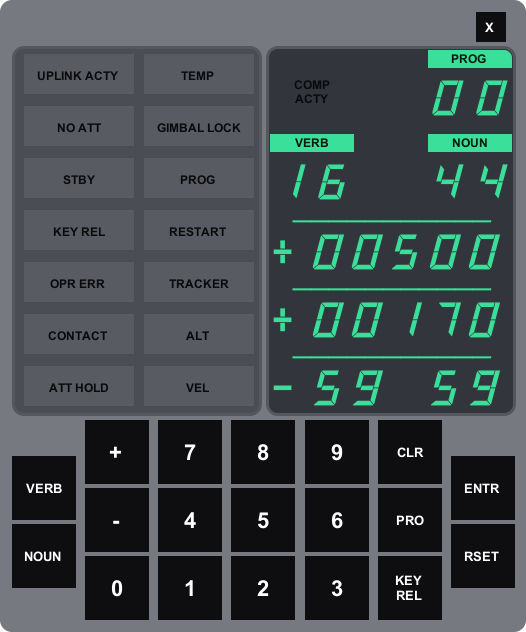

# LM Guidance Computer: Pilot's Manual

How to fly a powered descent and landing with the Apollo-inspired LM computer in KSP (kOS, Realism Overhaul, Sol).
For installation see the [README](../README.md).

Flown and confirmed: planning, P63 braking, P64 approach with redesignation (in `UP` window mode), P65 automatic landing, P66 rate of descent, touchdown; the J-class profile (planning, P63, P64, P66 straight from P64, touchdown). Not flown: `KEEP` window mode in P64.

## Contents

- [Flight at a glance](#flight-at-a-glance)
- [1. What you need](#1-what-you-need)
- [2. Starting up](#2-starting-up)
- [3. Planning the descent](#3-planning-the-descent)
- [4. The DSKY](#4-the-dsky)
- [5. The descent](#5-the-descent)
- [6. Messages](#6-messages)
- [7. Settings](#7-settings)
- [8. Differences from the real LM](#8-differences-from-the-real-lm)
- [9. If something goes wrong](#9-if-something-goes-wrong)

## Flight at a glance

The whole flight on one page. Details are in the sections that follow.

| # | Step | What you do |
|---|---|---|
| 1 | In orbit | Bound lunar orbit, no time warp. Type `RUN plan.` |
| 2 | Plan | Pick a site, press **PLAN**, then **SEND**, and close the planner with the cross in its corner |
| 3 | Deorbit | Fly the plane-change node (if any) and the DOI node yourself. Warp to each |
| 4 | P63 | After the DOI burn type `RUN dsky.`, then `V37 E 63 E`. The ship turns and warps you to 60 s before ignition (PDI) by itself |
| 5 | Ignition | At 5 s before ignition `V99 N62` flashes: press **PRO** to enable the engine |
| 6 | P64 | Starts by itself after braking. Press **PRO** to permit redesignation, then the KSP keys **W/S** (0.5°) and **A/D** (2°) move the aim point |
| 7 | P65 | Starts by itself. It nulls the horizontal speed and lands at 3 ft/s |
| 8 | P66 (optional) | SAS on, then **Shift** (slower) or **Ctrl** (faster) to set the rate of descent yourself |
| 9 | Touchdown | CONTACT lamp lights, the engine cuts off, PROG 68. Click the X in the window and YES to end the computer |

`V37 E 00 E` ends any programme at any time and hands the controls back (`V34 E` ends P63 only at its enable prompt, as the real V34 only answered a flashing request). The X in the window, then YES, ends the DSKY.

## 1. What you need

> **Not guaranteed.** This was developed and flown on one lander only (a Realism Overhaul LM, descent engine LMDE) in one setup: the Sol planet pack with Mirage and TiltEm, Realism Overhaul and kOS 1.6.0.1. It has not been tested on any other lander or setup, and it is not guaranteed to work at all. You fly it at your own risk.

- Mods used: Sol (replaces RSS), Mirage, TiltEm and Realism Overhaul. TiltEm tilts the spin axes, and the computer builds the Moon's spin from its north pole to allow for that.
- A lunar lander (the RO LM it was flown with: descent engine LMDE, RCS for ullage) in a bound lunar orbit above the PDI altitude, for example about 110 km circular.
- No time warp, and no maneuver nodes you want to keep (or tick "Replace existing maneuver nodes" in the planner).
- A kOS processor on the lander.

## 2. Starting up

Commands such as `RUN plan.` look in the current volume, which on a ship is its own disk until you type `SWITCH TO 0.` once. To skip that, choose `boot/lm_boot.ks` as the boot file of the kOS processor in the VAB or SPH (right-click the part, "Boot file"); it selects the archive each time the ship loads.

The planner and the DSKY are two separate scripts, because a kOS processor runs one script at a time. In the kOS terminal, first:

```
RUN plan.
```

The **planner window** opens (section 3). Plan, press SEND (unless you ticked Skip simulated uplink), close the planner with the cross in its corner, and fly the burns. Then start the DSKY:

```
RUN dsky.
```

The **DSKY window** opens on the site and landing time in its erasable store, and `V37 E 63 E` starts P63. With the uplink (the default) `SEND` in the planner writes the keys the DSKY presses in when it starts; with Skip simulated uplink ticked the saved plan fills the store when the DSKY starts. If nothing is loaded the DSKY still runs, but P63 refuses: OPR ERR lights and the terminal says what is missing. Load it (section 4, "Loads and uplink"), or end the DSKY with the X in its window, run the planner and start the DSKY again. The store is kept when the DSKY ends (file `0:/lm/store.txt`) and read back at the next start, as the computer's erasable memory stayed; a new plan from the planner deletes it. Start the DSKY before the descent and do not restart it during the descent.

This differs from 1.0, where `RUN start.` opened the planner and then the DSKY, and the DSKY could take a site as an argument or fall back to the point under the next perilune. The DSKY now takes its site from the saved plan only.

## 3. Planning the descent

In the planner window:


*The planner window, one column: landing site (menu, LAT, LONG), parameters (pad loads, windows up, largest plane change, replace nodes, skip simulated uplink), PLAN and SEND, the PAD, and a one-line result; the cross in the top corner closes it.*

1. Pick an Apollo landing site from the menu, or choose Custom and type a latitude and longitude (degrees; east is positive). The height is always the terrain height at the site.
2. Optional: set the largest plane-change burn you will accept (m/s, default 200), tick "Replace existing maneuver nodes", and tick or clear **Windows up in P63**: ticked (`UP`, later missions) the ship turns so the window faces the site, clear (`KEEP`, Apollo 11) the roll is kept.
3. Choose the **pad loads and descent guidance**: "Apollo 11 (Luminary 099)" (the default, as in 1.1) or "J-class (Luminary 210, Apollo 15 to 17)", which uses the Apollo 17 pad loads and the later guidance (see "J-class descent" in section 5). The choice is saved with the plan.
4. Press **PLAN**. The line under the buttons reads "Plan OK! DOI: HH:MM, PDI: HH:MM, LDG: HH:MM" (universal time, hours and minutes: set the game's clock to UT and these are the times it shows when each burn happens), or says why it failed. The planner adds up to two maneuver nodes: a plane change (only if the site is more than 2 km out of your orbit plane) and the DOI burn that puts you on the descent orbit, with PDI (powered descent initiation) at the perilune.
5. If it fails it removes its own nodes and says why (no bound orbit, time warp on, terrain too low on the descent orbit, plane change too large...).
6. The cross in the top right corner leaves the nodes in place and ends the planner. Fly the burns, then start the DSKY (section 2).

**The uplink and Skip simulated uplink (1.3).** The **Skip simulated uplink** box under the pad loads chooses how the plan reaches the DSKY. **Cleared** (the default) turns the plan into a **PAD**, the data Mission Control would have read up, written as keystrokes, and saves nothing for the DSKY: press **SEND**, start the DSKY and it presses the uplink in, as the real ground's uplink loaded the computer. **Ticked** saves the plan and the DSKY loads the site, the landing time and the DOI burn by itself at start: nothing for you to do, as in 1.2.

- The PAD has an UPLINK part: V71 blocks for the landing-site vector `RLS`, the landing time `TLAND`, and the DOI burn (its delta-v and ignition time as one eight-word block, the real ground's external delta-v update). The DOI burn is the LM's only burn: a plane-change burn is the CSM's in Apollo (the LM made none before PDI), so it is flown from its node and the PAD only adds a line saying it is not loaded in the LM. Nothing in the PAD is keyed by hand. Each block has a heading with its address, a line of what it holds in plain numbers (the site's latitude, longitude and height; the landing time as hours:minutes:seconds; the burn's `TIG` and `DV` as N33 and N81 will show them, so you can check the PAD against the display) and its keys, laid out with spaces: `V71 E`, the count, the address, then the words, each followed by `E`, and `V33 E` at the end. The header names the software version and the clock zero used (the AGC clock counts from the mission time zero of the vessel the planner ran on, in centiseconds; KSP restarts a vessel's mission time when it undocks, so the planner saves that zero in `0:/lm/clock.txt` and the DSKY uses it, which lets you plan docked, undock and then key the PAD).
- **SEND** writes the UPLINK keys to `0:/lm/uplink.txt`. Start the DSKY (`RUN dsky.`) and leave it in P00: it presses the keys in by itself, one every fifth of a second, with the UPLINK ACTY lamp lit, and the site, the landing time and the DOI burn are loaded. You can also type the same keys by hand (section 4); that is a fallback, not something the crew did.
- With the uplink (Skip simulated uplink cleared) the DSKY takes its software version from `PAD_PROFILE` in `lm_config.txt` (there is no plan to carry it), so set it there to match the menu; the window warns when they differ.
- A plan with the uplink removes `plan.json` and any old `uplink.txt` once it has worked, so the DSKY starts with nothing loaded. A failed plan changes neither.

The pad loads are those of the profile you chose, for every site. A site with rough terrain under the descent orbit is refused rather than flown into.

**Fly the nodes yourself** (kOS does not steer them), warping to each as usual. After the DOI burn you are on the descent orbit. You do not need to coast or warp to PDI: start P63 straight away (section 5) and it warps you there.

## 4. The DSKY

A window shaped like the LM's DSKY: PROG, VERB, NOUN and three data registers R1, R2, R3, with lamps and a keypad.



*The DSKY in P63 braking: PROG 63, `V16 N60` (R1 horizontal speed and R2 descent rate in tenths of ft/s, R3 calculated height in ft). COMP ACTY (the computer is working) is lit, and so are the amber ALT and VEL lamps.*

**Lamps that work:**

| Lamp | Lit when |
|---|---|
| COMP ACTY | the computer is working: it flickers with each cycle of a running programme and blips when a displayed value changes or a key is processed. Dark when nothing is running |
| PROG | a programme alarm (1406, time-to-go not converged) |
| OPR ERR | a bad key entry or a refused programme. **RSET** clears it |
| KEY REL | the programme wants the display back (for example at the engine prompt) |
| ALT | the landing radar's altitude data is not good (above 12 km, or it fails the check) |
| VEL | the landing radar's velocity data is not good (above 2000 ft/s, or it fails the check) |
| CONTACT | the lander has touched down |

The other lamps (UPLINK ACTY, NO ATT, STBY, TEMP, GIMBAL LOCK, RESTART, TRACKER) are placeholders and never light.

### Working the DSKY

You work the DSKY by clicking the on-screen buttons. Single buttons are written in bold, like **PRO**. Verb and noun entries are written as shorthand in code style: `V37 E 63 E` means click VERB, 3, 7, ENTR, 6, 3, ENTR; `V16 N61 E` means VERB, 1, 6, NOUN, 6, 1, ENTR (V is VERB, N is NOUN, E is ENTR).

| Button | Does |
|---|---|
| **VERB**, **NOUN** + two digits | Enter a verb or noun |
| **ENTR** | Accept what you keyed |
| **PRO** | Proceed: enable the engine, allow redesignation |
| **CLR** | Clear the digits you are keying |
| **RSET** | Clear the OPR ERR lamp |
| **KEY REL**, **+**, **-** | Do nothing yet |

The keyboard also works, but only while the kOS terminal window has focus (click it first): V, N, digits, E (ENTR), P (PRO), C (CLR), R (RSET). Clicking the DSKY buttons needs no focus, so it is the way to do it.

Flying keys are different: **W/S/A/D**, **Q/E**, **Shift** and **Ctrl** are KSP's own flight keys, read while the KSP window has focus.

#### How verbs and nouns work

The VERB and NOUN cells say two things:

- The **verb** is what you want done: show something, or change the programme.
- The **noun** is which data the three registers R1, R2 and R3 show (speed, height, time...).

To change what the display shows, key a verb and a noun and press ENTR: `V16 N61 E`. At start the display is blank except PROG `00`, like a real DSKY after a fresh start: key a verb and a noun to see anything (a noun with no verb, or a verb that needs a noun without one, lights OPR ERR). Set `DSKY_START = N60` in `lm_config.txt` to have `V16 N60` up from the start instead (a departure from Apollo, handy as a descent monitor).

- While you key a verb or noun, the digits you type appear in its cells and the VERB/NOUN line flashes until you press **ENTR**.
- You can key only the noun (`N61 E`) and keep the verb, or only the verb and keep the noun.
- **CLR** drops the digits you are keying. Pressing **VERB** or **NOUN** again starts the entry over.
- A number the computer does not know, or digits keyed without pressing **VERB** or **NOUN** first, lights **OPR ERR** and changes nothing. Press **RSET** to clear it.
- Changing the programme takes two steps: `V37 E` makes the display wait for a programme number, then the two digits and **ENTR**: `V37 E 63 E`. Pressing **VERB** or **NOUN** instead cancels the wait.

During a programme you rarely key anything, because the programme sets the verb and noun at each step (see "What each programme displays by itself" below).

#### Verbs

| Verb | Does |
|---|---|
| `V06 N## E` | Display a noun's registers |
| `V16 N## E` | Monitor a noun: the registers keep updating |
| `V37 E 63 E` | Change programme: start P63. `V37 E 00 E` ends the running programme |
| `V34 E` | Terminate, as in Luminary it only answers a request: during a keyed load or an update it abandons that; at P63's "please enable engine" request (V99) it ends P63 and switches the ullage off; with nothing pending it does nothing. It never ends the DSKY (use the X in the window); `V37 E 00 E` ends a programme |
| `V21 N## E` to `V25 N## E` | Keyed load of a noun's registers (nouns 33 and 81), see "Loads and uplink" |
| `V71 E`, `V72 E`, `V33 E` | The update programme P27 (octal uplink), see "Loads and uplink" |
| V99 | Shown by P63 itself, flashing, to ask you to enable the engine. You answer with **PRO**. You never key it |

On the real DSKY V06 shows a noun once and V16 keeps updating it. Here both update live, so either works. The programmes use V06, and the manual uses V16 when you key one yourself. Only P63 can be started (P00 ends it): P64, P65 and P66 start by themselves.

#### Nouns

Units are Apollo's: feet, ft/s, nautical miles. A register is five digits with no decimal point (the real DSKY has none): speeds are in tenths of a ft/s (`-00030` is a descent of 3.0 ft/s, as Luminary's VELOCITY3 `XXXX.X`), distances in tenths of a nautical mile, heights in whole feet. A register driven by a noun always shows a number: until P63 or P64 supplies a value it shows zeros (`+00 00`, `+00000`), as Luminary's displays do with an erasable nothing has written to. A register is blank only when there is no navigation state at all. The real DSKY cannot show dashes, only digits or blank.

| Noun | R1 | R2 | R3 |
|---|---|---|---|
| N60 | horizontal speed (0.1 ft/s) | descent rate (0.1 ft/s) | height above the site (ft) |
| N61 | braking time to go (`MM SS`) | time to ignition (`+MM SS`, negative after ignition) | out-of-plane distance (tenths of a nm, five digits) |
| N62 | speed along the burn (0.1 ft/s) | time to go (`MM SS`) | delta-v gained (0.1 ft/s) |
| N63 | speed along the burn (0.1 ft/s) | descent rate (0.1 ft/s) | height (ft) |
| N64 | seconds left to redesignate and look angle (deg), as `+TT LL` | descent rate (0.1 ft/s) | height (ft) |
| N68 | range to the site (tenths of a nm, five digits) | braking time to go (`MM SS`, as N61 R1) | height difference (ft) |
| N33 | hours | minutes | seconds in hundredths (the time of ignition from the clock zero) |
| N81 | delta-v X (0.1 ft/s) | delta-v Y (0.1 ft/s) | delta-v Z (0.1 ft/s) (local vertical axes) |

#### Loads and uplink (1.3)

The DSKY has a small erasable store of the cells the descent needs: the landing site `RLS`, the landing time `TLAND`, a burn's ignition time `TIG` (noun 33) and delta-v `DELVLVC` (noun 81, local vertical axes), each at its real Luminary address and scaling. Data get in two ways, as in the real mission.

**Keyed load (V21 to V25).** `V25 N33 E` loads the three registers of noun 33; the VERB and NOUN cells flash. Key a sign (**+ or -, required**: N33 and N81 are decimal-only nouns, and digits keyed with no sign are read as octal, so ENTR is OPR ERR and the load starts again from the first register), **all five digits** (leading zeros too: `+00025`) and **ENTR** for each register in turn; the digits appear left to right as you key them, not padded; the load is stored after the last **ENTR** and the display goes to `V16` on the same noun. `V21`, `V22`, `V23` load only R1, R2, R3, `V24` R1 and R2. **ENTR** with fewer than five digits is OPR ERR and the load keeps waiting, so you can key the missing digits (as PINBALL does for a decimal load); **PRO** leaves that register as it was and goes on; **CLR** drops what you keyed in the register; a sixth digit, or a sign anywhere but first, is ignored (no alarm, as in PINBALL). **RSET**, or any verb keyed and entered (`V34 E` ends only the load), abandons the load and changes nothing. N33 is hours, minutes and seconds in hundredths (`+00083 +00003 +02000` is 83 h 03 min 20.00 s from the clock zero); N81 is delta-v in tenths of ft/s along the local vertical axes (X along the track, Y opposite the orbit normal, Z down). Only noun 33 and 81 can be loaded. Nothing flies the loaded burn yet: P30 and P40 arrive in a later release, and until then the numbers are stored and shown.

**Update programme P27 (V71, V72).** Accepted only in P00 (no programme running). Everything is octal, as on the real uplink:

| Keys | Does |
|---|---|
| `V71 E`, `II E`, `AAAA E`, then `XXXXX E` for each word, `V33 E` | Block update: write the words at the address (ECADR) `AAAA` and on. `II` is the number of words plus 2 (3 to 24 octal, that is at most 18 words) |
| `V72 E`, `II E`, then `AAAA E` `XXXXX E` pairs, `V33 E` | Scatter update: `II` is odd (3 to 23 octal), twice the pairs plus 1 |
| `V34 E` | Throw the block away |

While P27 is active the PROG display shows 27 (and the old programme number returns afterwards), `V21 N01` flashes, R1 shows the octal digits you key, left to right, not padded (an update word may be keyed with fewer than five digits), and R3 shows the address of the update buffer the word is going to, counting up by one for each item received (the count, the ECADR, then each word; for Apollo 11 it starts at 01174, for J at 01173), and at the verify step (`N02`) the address of the scratch word (01167 or 01166); after the last word it shows `N02` and waits for **V33** (store) or **V34**. An 8 or 9 lights OPR ERR and is ignored, a sixth digit is ignored (as on the real DSKY) and the update goes on. A count out of range, nothing keyed before **ENTR**, or an address that is not a cell the store holds, throws the whole block away: OPR ERR and a line on the terminal, nothing written. The PAD gives the exact keys. The UPLINK ACTY lamp lights while keys arrive from the uplink file and P27 is active.

#### Useful ones

| Keys | Why |
|---|---|
| `V16 N60 E` | The general descent view: how fast you are moving sideways, how fast you are falling, how high. Before P63, a check of your height above the site |
| `V16 N68 E` | The range to the landing site. Before P63 it tells you how far you still are |
| `V16 N61 E` | During P63: the braking time to go and the time to ignition |
| `V16 N64 E` | The look angle to the site, to judge a redesignation |
| `V37 E 63 E` | Start P63 |
| `V34 E` | Terminate (only answers a request: a load, an update or P63's enable prompt; the X in the window ends the DSKY) |

#### What each programme displays by itself

| When | VERB NOUN | R1 | R2 | R3 |
|---|---|---|---|---|
| P63 countdown (TIG-30 to TIG-5) | `V06 N62` | speed along the burn | time to ignition (`+MM SS`) | delta-v gained |
| P63 engine prompt (TIG-5, flashing) | `V99 N62` | same as above | same | same |
| P63 burning | `V06 N63` | speed along the burn (0.1 ft/s) | descent rate (0.1 ft/s) | height (ft) |
| P64 approach | `V06 N64` | seconds left to redesignate and look angle (deg), `+TT LL` | descent rate (0.1 ft/s) | height (ft) |
| P65 and P66 | `V06 N60` | horizontal speed (0.1 ft/s) | descent rate (0.1 ft/s) | height (ft) |

You can key a different noun at any time during a programme and the programme carries on. The programme only sets the display when its state changes (the countdown, the engine prompt, the engine lighting, the hand-over to the next programme), so a noun you key stays until the next change.

## 5. The descent

The programmes follow each other: P63 → P64 → P65, and P66 if you take over the rate of descent.

### Before P63

After the DOI burn, with the DSKY open, start with `V37 E 63 E`. You do not coast or warp to PDI yourself: P63 does it.

### P63: braking

The lander turns to the burn attitude, then warps all the way to 60 s before ignition (cancel the warp with KSP's own cancel key if you like; it does not restart). Then:

- The display is blank until 35 s before ignition, then counts down from 30 s.
- RCS ullage fires at about 7.5 s before ignition.
- At 5 s before ignition the display shows `V99 N62` flashing and the terminal says "PLEASE ENABLE ENGINE: PRESS PRO". Press **PRO** to enable the engine.
- The engine lights at ignition and goes to full throttle 26 s later.

The SAS button is the AUTO / ATT HOLD switch: SAS on holds attitude, SAS off lets P63 steer. `V16 N61 E` shows the braking time to go in R2. P63 hands over to P64 by itself when braking is almost over (time to go below 62 s).

### P64: approach and redesignation

PROG shows 64 and the display `V06 N64` flashing. R1 is the seconds left to redesignate and the look angle in degrees (`+TT LL`, two digits each, as Luminary's FUNNYDSP), R2 the descent rate (0.1 ft/s), R3 the height (ft). P64 steers and throttles to the approach targets and hands over to P65 by itself about 150 s later.

**Redesignation** (moving the aim point): press **PRO** once to permit it (the flashing stops). Then, with SAS off (AUTO only), use the KSP flight keys:

- Each tap of the pitch keys (W, S) moves the aim point 0.5°.
- Each tap of the yaw keys (A, D) moves it 2°.

A held key counts as one click. R1 changes with each click (the terminal prints nothing per click). It closes about 34 s before the end of P64. A green arrow stands on the landing site in the flight view during P64 and follows the aim point; the labelled green pin shows in map view. When the window closes the terminal prints "REDESIGNATION CLOSED".

### P65: automatic landing

PROG shows 65 and the display `V06 N60`: R1 horizontal speed, R2 descent rate, R3 height. The top three lines of the terminal show a live readout: "DESCENT RATE" in m/s (positive going down), the P65 target or in P66 the commanded rate, and a key hint. The terminal is cleared when the readout first appears and again when P65 becomes P66 and at touchdown, so older messages do not sit beneath it. P65 nulls the horizontal speed and settles to a descent of 3 ft/s (0.9 m/s), following the guidance direction. The ship keeps its roll (a roll key still rolls it in AUTO). You can let it land by itself.

### P66: you control the rate of descent

Switch SAS on (the ATT HOLD switch), then tap **Shift** (slower descent) or **Ctrl** (faster descent). Each tap is one rate-of-descent click of 1 ft/s, and the first one starts P66 (PROG 66). The top lines of the terminal show the descent rate and the commanded rate in m/s. In P66 the throttle holds your commanded rate and you fly the attitude yourself with SAS on. A click in AUTO (SAS off) is ignored, as in Luminary.

### Touchdown

The CONTACT lamp lights when the lander touches down, the engine cuts off a quarter of a second later (you can stop it first) and PROG shows 68. The programme ends and the controls are yours.

`V37 E 00 E` ends any programme at any time and hands the controls back (`V34 E` ends P63 only at its enable prompt, as the real V34 only answered a flashing request). The X in the window, then YES, ends the DSKY.

### J-class descent (Luminary 210)

With the J-class profile (`RUN dsky.` prints `LUMINARY210`) P63 and P64 work as above, with the Apollo 17 pad loads and these differences:

- The ignition point is lower and further out, so the planner puts the descent orbit's perilune about 16.8 km up (Apollo 11: 15.8 km).
- P64 is shorter at its start (the time-to-go step is -70 s, not -110 s), and each redesignation click moves the aim point **1 degree** on both axes (pitch keys and yaw keys).
- **There is no P65.** When the time to go falls below 12 s, P64 hands over to **P66** straight away. P66 holds the descent rate the approach had at that moment, and Shift and Ctrl change it by 1 ft/s a click, in AUTO or with SAS on. The top lines of the terminal show the descent rate, the commanded rate and the horizontal speed.
- In P66 the guidance also **nulls the horizontal speed** over the ground by itself: the thrust leans against the drift (time constant about 7 s). You can let it land by itself.
- The landing radar is not used below 50 ft (15 m).


## 6. Messages

The terminal prints a short message at each step: "P63: ENGINE ON", "P64: REDESIGNATION PERMITTED...", "CONTACT...", "P68: LANDING CONFIRMED". Warnings and refusals are always shown.

**P63 refused** (OPR ERR lights; press **RSET** to clear it):

| Message | Cause | Fix |
|---|---|---|
| RLS (the landing site) is not loaded | nothing loaded: no plan, or an uplink plan that was not sent | press SEND in the planner (or tick Skip simulated uplink), or load RLS and TLAND from the PAD |
| TLAND (the landing time) is not loaded | the site is loaded but not the landing time | load TLAND from the PAD (V71) |
| saved plan is for another landing site | you started the computer with a different site | plan again |
| the planned PDI time has passed | you missed PDI | plan again |
| the orbit is not bound | not in orbit | get into orbit |
| no engine found | the computer found no engine on the ship | check staging |

**Alarm 1406 / PROG lamp:** the time-to-go calculation did not converge. The guidance keeps the last value and carries on.

## 7. Settings

The defaults are tuned for the RO LM. The settings in the table below can be changed in a plain text file, `lm_config.txt` (installed as `Ships/Script/lm/lm_config.txt`). Every setting in it starts commented out with `//`: remove the `//` in front of a setting, change its value, save, and start the DSKY again (`RUN dsky.`). A line with an unknown name or a bad value is skipped and the terminal says so when the DSKY starts. The other tuning constants stay in `lm_constants.ks` (same folder); edit them there only if you know what they do.

| Setting | Default | Use |
|---|---|---|
| `LM_LOG` | FALSE | TRUE writes diagnostic logs to `0:/lm/logs/` (`p63.log`, `p64.log`, `p65.log`, `lm_check.log`, `lm_deorbit.log`). Useful for bug reports |
| `P63_WINDOW_MODE` | `UP` | Default crew window mode (the planner window sets it too) |
| `P63_WARP_LEAD_S` | 60 | Seconds before ignition at which the warp stops |
| `PAD_PROFILE` | `A11` | `A11` (Luminary 099, Apollo 11) or `J` (Luminary 210): the flight software version, which picks the pad loads, the programmes and the store's addresses. The planner menu sets it too; a saved plan carries it and wins. With the uplink (Skip simulated uplink cleared) set it here to match the menu |
| `DSKY_START` | BLANK | `BLANK` or `N60`: what the DSKY shows when it starts |
| `P64_PITCH_SIGN`, `P64_YAW_SIGN` | -1, -1 | Flip if a redesignation key moves the aim point the wrong way |
| `P66_ROD_SIGN` | 1 | Flip if Shift/Ctrl change the rate the wrong way |
| `BODY_NAME` | `Moon` | The body you land on |

## 8. Differences from the real LM

- The computer is not an AGC emulation: it recreates what the crew saw and did, using KSP data. The guidance equations are ported from the Luminary 099 source (the Apollo 11 LM software).
- The cycle is 0.25 s, not Luminary's 2 s, for a smoother display.
- Touchdown cut-off is automatic. The crew stopped the engine by hand.
- The ignition and descent geometry is the Apollo 11 pad load for every site, and the planner fits your orbit to it.
- The planner replaces mission control: it finds the DOI burn and the PDI time for you.
- The RO LMDE gives more thrust than the throttle command at low settings. P65 and P66 compensate with the engine's measured throttle curve and a thrust trim.
- The landing radar is simulated from the terrain height kOS gives, so the ALT and VEL lamps follow Luminary's tests on that data. Only the lamps listed in section 4 are driven. The + and - keys work in a keyed load and the KEY REL key does nothing. V37, V34, V06, V16, V21 to V25, V33, V71, V72 and V99 are the only verbs.
- `KEEP` window mode in P64 is assumed, not flown.
- Loads and uplink (1.3): the erasable store holds only the cells in use, with Luminary's addresses and scaling, but no memory is emulated. The uplink is a stream of key presses read from a file, with no hardware error checking, and V70 and V73 (clock and liftoff-time increments) and the state-vector loads are not implemented. A bad update count or address is OPR ERR and the block is discarded (Luminary asks again or alarms), and the component-correction loop of the verify display is not implemented. RSET ends a keyed load (on the real DSKY it only clears the lamp) and PRO keeps a register's old value. The landing-site vector uses a simple body-fixed frame (x through latitude 0, longitude 0, z north), not Luminary's lunar-libration frame. The PAD's delta-v is in Luminary's local vertical axes at the burn point (Z down along the radius, Y opposite the orbit normal, X along the horizontal part of the velocity), exact for an elliptical orbit too. The AGC clock zero is the mission time zero of the vessel the planner ran on (saved in `0:/lm/clock.txt`, the clock sync the ground would have uplinked), and the clock holds about 31 days. What the PAD uplinks and what it has you key follows the Apollo planning documents and the Luminary 1E data-links manual (docs/superpowers/ground-uplinks-research.md): the landing site and time and the DOI burn's delta-v and ignition time are uplinked. The plane-change burn belongs to the CSM (the LM made none before PDI), so it is flown from its node and the PAD only notes it (the store holds one burn's data at a time, like P30's cells). The landing time sets the PDI time (landing minus 755 s). The planner still adds the KSP maneuver nodes; the burns are flown by hand until the computer flies them itself in a later release. The software version and the window mode are settings, not data you load.
- J-class (1.2): the Apollo 17 pad loads are used as read from the printed load; the three missions share them except the ignition point and one timing value. P66 leaves out Luminary's alarm 1466 logic, the engine-arm test and the early P66 start from a ROD click in P63 or P64, and the programme ends at engine cut-off, so the PROCEED that ends the horizontal control after touchdown is not needed.

## 9. If something goes wrong

- **A key moves the wrong way:** see the sign settings in section 7.
- **P63 refuses to start:** see the table in section 6.
- **Anything else:** the X in the DSKY window (then YES) ends the LM computer and gives you the controls. To report a bug, set `LM_LOG` to TRUE, fly again and send the logs from `0:/lm/logs/`.
