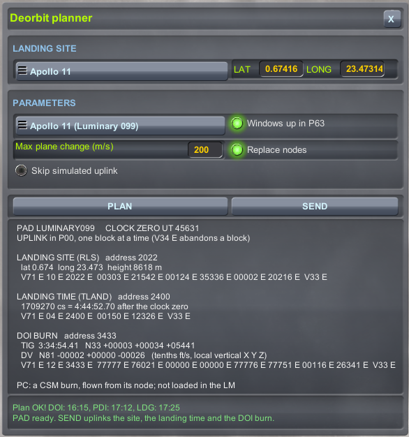

# LM Guidance Computer: Pilot's Manual

How to fly a powered descent and landing in Kerbal Space Program (KSP) with an Apollo-style Lunar Module (LM) guidance computer, written in kOS and built for Realism Overhaul (RO) and the Sol planet pack. For installation see the [README](../README.md).

The Apollo Lunar Module (LM) was flown by the Apollo Guidance Computer (AGC), and the crew talked to it through the **DSKY** (display and keyboard, said "diskey"): a small panel of numeric displays, warning lamps and a keypad. This computer gives you that panel as a window, and the same descent software behaviour behind it. It recreates what the crew saw and did; it does not emulate the AGC's hardware. The guidance is ported from *Luminary 099*, the name of the LM software on Apollo 11. A second profile, "J-class", follows *Luminary 210*, flown on Apollo 15 to 17.

> **Not guaranteed.** It was developed and flown on one lander (an RO LM with the descent engine LMDE, the Lunar Module descent engine) in one setup: Sol with Mirage and TiltEm, Realism Overhaul and kOS 1.6.0.1. Nothing else has been tested, and it may not work at all elsewhere. You fly it at your own risk.

A one-page [quick reference](#appendix-a-quick-reference) and a [glossary](#appendix-b-glossary) of the Apollo terms are at the end.


## Contents

- [1. Before you start](#1-before-you-start)
- [2. The flight at a glance](#2-the-flight-at-a-glance)
- [3. Starting up](#3-starting-up)
- [4. Planning the descent](#4-planning-the-descent)
- [5. Flying the descent](#5-flying-the-descent)
- [6. The DSKY](#6-the-dsky)
- [7. Alarms and refusals](#7-alarms-and-refusals)
- [8. Settings](#8-settings)
- [9. Differences from the real LM](#9-differences-from-the-real-lm)
- [10. If something goes wrong](#10-if-something-goes-wrong)
- [Appendix A: Quick reference](#appendix-a-quick-reference)
- [Appendix B: Glossary](#appendix-b-glossary)

## 1. Before you start

You need:

- the mods above (TiltEm tilts the Moon's spin axis; the computer allows for it by building the spin from the north pole);
- a lander with a kOS processor, a descent engine and RCS thrusters for ullage, in a bound lunar orbit above the powered-descent altitude, for example 110 km circular;
- no time warp running, and no maneuver nodes you want to keep (or tick "Replace existing maneuver nodes" in the planner).

## 2. The flight at a glance

| # | Step | What you do |
|---|---|---|
| 1 | In orbit | Bound lunar orbit, no time warp. Type `RUN plan.` |
| 2 | Plan | Pick a site, press **PLAN**, then **SEND**, and close the planner with the cross in its corner |
| 3 | Deorbit | Fly the plane-change node (if any) and the DOI node yourself, warping to each. DOI, descent orbit insertion, is the burn that lowers the perilune to where the landing begins |
| 4 | P63 | Type `RUN dsky.`, then `V37 E 63 E` (key VERB 37, ENTR, 63, ENTR: start programme 63, braking). The ship turns and warps to 60 s before ignition by itself |
| 5 | Ignition | At 5 s before ignition `V99 N62` flashes: press **PRO** to enable the engine |
| 6 | P64 | Starts by itself after braking. **PRO** permits redesignation, then **W/S** (0.5°) and **A/D** (2°) move the aim point |
| 7 | P65 | Starts by itself. It nulls the horizontal speed and lands at 3 ft/s |
| 8 | P66 (optional) | SAS on, then **Shift** (slower) or **Ctrl** (faster) to set the rate of descent yourself |
| 9 | Touchdown | The CONTACT lamp lights, the engine cuts off, PROG shows 68. The X in the window, then YES, ends the computer |

`V37 E 00 E` ends any programme at any time and hands the controls back.

## 3. Starting up

A kOS processor on a ship reads its own disk until you type `SWITCH TO 0.` once, to select the archive. To skip that, choose `boot/lm_boot.ks` as the processor's boot file in the VAB or SPH (right-click the part, "Boot file").

A processor runs one script at a time, so the planner and the DSKY are separate. In the kOS terminal:

```
RUN plan.
```

opens the **planner** (section 4). Plan, press **SEND**, close the planner and fly the burns. Then:

```
RUN dsky.
```

opens the **DSKY window**. `V37 E 63 E` starts P63.

If the DSKY has nothing loaded, P63 refuses: the OPR ERR (operator error) lamp lights and the terminal says what is missing (section 7). The DSKY keeps its loaded data in `0:/lm/store.txt` when it ends and reads it back at the next start, as the AGC's erasable memory stayed; a new plan deletes it. Start the DSKY before the descent and do not restart it during the descent.

## 4. Planning the descent



*The planner: landing site, parameters, PLAN and SEND, the PAD, and a one-line result. The cross in the top corner closes it.*

1. **Choose the site.** Pick an Apollo landing site from the menu, or choose Custom and type a latitude and longitude in degrees (east positive). The height is always the terrain height at the site.
2. **Set the options** (all optional). The largest plane-change burn you will accept (default 200 m/s); "Replace existing maneuver nodes"; and **Windows up in P63**. Ticked (`UP`, later missions) the ship turns so its window faces the site. Cleared (`KEEP`, Apollo 11) it keeps its roll.
3. **Choose the software:** "Apollo 11 (Luminary 099)" (the default) or "J-class (Luminary 210, Apollo 15 to 17)", which uses the Apollo 17 pad loads and the later guidance (section 5). The choice is saved with the plan.
4. **Press PLAN.** The line below reads "Plan OK! DOI: HH:MM, PDI: HH:MM, LDG: HH:MM", or says why it failed. The times are UT, so with the game clock set to UT they match what you see when each burn happens. DOI is the burn onto the descent orbit; PDI, powered descent initiation, is the ignition of the descent engine that begins the landing, near the perilune of that orbit; LDG is landing. The planner adds up to two maneuver nodes: a plane change (only if the site is more than 2 km out of your orbit plane) and the DOI burn.
5. **If it fails** it removes its own nodes and says why: no bound orbit, time warp on, terrain too low on the descent orbit, plane change too large. A site with rough terrain under the descent orbit is refused rather than flown into.
6. **Close the planner** with the cross. The nodes stay. Fly them yourself (kOS does not steer them), warping to each as usual. After the DOI burn do not coast to PDI: start P63 at once and it warps you there.

### The PAD and the uplink

The planner also prepares what Mission Control would have read up to the crew: a **PAD** (pre-advisory data, the sheet of numbers for a burn or landing), written as keystrokes. The **Skip simulated uplink** box chooses how the plan reaches the DSKY.

- **Cleared (default).** Press **SEND** and start the DSKY, which presses the keys in by itself, as the ground's uplink loaded the AGC. SEND writes the keys to `0:/lm/uplink.txt`; the DSKY presses them at five a second while it is in P00 (no programme), with the UPLINK ACTY lamp lit. You can type the same keys by hand (section 6), but that is a fallback.
- **Ticked.** The planner saves the plan and the DSKY loads it at start with nothing for you to do.

The PAD loads three things with V71 update blocks (verb 71 feeds the update programme P27, which accepts data sent from the ground): the landing-site vector (`RLS`, the site's position), the landing time (`TLAND`) and the DOI burn (its delta-v and time of ignition, as one block). A plane-change burn was the job of the command and service module (CSM), the Apollo mothership, so the PAD only notes that the LM does not load it. Each block has a heading with its address, a line in plain numbers (so you can check it against the display) and its keys. The header names the software version and the clock zero.

The AGC clock counts from the vessel's mission time zero, which KSP restarts when a vessel undocks. The planner therefore saves that zero in `0:/lm/clock.txt` for the DSKY, which lets you plan docked, undock, then send the PAD.

With the uplink, the DSKY takes its software version from `PAD_PROFILE` in `lm_config.txt` (section 8), because there is no saved plan to carry it. Set it to match the planner's menu; the window warns if they differ. A plan that has worked removes `plan.json` and any old `uplink.txt`, so the DSKY starts with nothing loaded; a failed plan changes neither.

## 5. Flying the descent

Four Luminary programmes fly the landing: **P63** braking, **P64** approach, **P65** automatic landing and **P66** rate-of-descent control. P63, P64 and P65 follow each other, with P66 if you take over the rate of descent. **P68** confirms the landing, and P00 is the idle state with no programme running. The SAS button is the AUTO / ATT HOLD switch of the real panel: SAS off is AUTO and lets the computer steer; SAS on is ATT HOLD (attitude hold) and keeps the attitude you have.

The key sequences in this section are all you need for a normal landing; section 6 explains the DSKY in full.

**A normal landing, key by key**

1. `V37 E 63 E` starts P63. `V06 N61` flashes.
2. **PRO**: the ship turns to the burn attitude and warps to 60 s before ignition.
3. At 5 s before ignition `V99 N62` flashes. **PRO** again enables the engine.
4. The engine lights and burns. There is nothing to key (`V16 N60 E` shows speeds and height if you want them).
5. P64 starts by itself. **PRO** permits redesignation, then **W/S/A/D** move the aim point.
6. P65 lands the ship by itself. To fly the rate of descent yourself, switch SAS on and tap **Shift** or **Ctrl** (P66).
7. After CONTACT, P68 shows your landing position. **PRO** ends it.

### What each programme displays

| When | Display | R1 | R2 | R3 |
|---|---|---|---|---|
| P63 start (until **PRO**) | `V06 N61` flashing | braking time to go | time to ignition | out-of-plane distance |
| P63 countdown (30 s to 5 s) | `V06 N62` | speed along the burn | time to ignition | delta-v gained |
| P63 engine prompt (5 s) | `V99 N62` flashing | as above | | |
| P63 burning | `V06 N63` (J-class: flashing until `V57 E`) | speed along the burn | descent rate | height |
| P63, engine gives no thrust | `V97 N62` flashing | | | |
| P64 | `V06 N64`, flashing while redesignation is open | seconds left and look angle | descent rate | height |
| P65 and P66 | `V06 N60` (J-class P66: flashing) | horizontal speed | descent rate | height |
| P68 (down) | `V06 N43` flashing | latitude | longitude | height |

### Starting P63

With the DSKY open after the DOI burn, key `V37 E 63 E`. P63 starts with `V06 N61` flashing, where Luminary asks the crew to reset the event timer, a stopwatch on the panel. Until you press **PRO** the lander holds its attitude and does not warp. If you never press it, P63 goes on by itself at 35 s before ignition. Keying over the display lights KEY REL; the **KEY REL** button brings it back (`V16 N33 E` first, then KEY REL, checks the ignition time).

### P63: braking

The lander turns to the burn attitude and warps to 60 s before ignition (cancel it with KSP's own warp-cancel key if you like; it does not restart). Then:

- The display is blank until 35 s before ignition, then counts down from 30 s.
- RCS ullage fires at about 7.6 s before ignition.
- At 5 s `V99 N62` flashes and the terminal says "PLEASE ENABLE ENGINE: PRESS PRO". Press **PRO**.
- The engine lights at ignition and goes to full throttle 26 s later.
- **V97:** if the engine gives no thrust (under 0.18 m/s² for about 20 s after ignition, or about 8 s after it first had thrust and lost it), `V97 N62` flashes. **PRO** restarts the monitoring; **ENTR** shuts the engine down and lights it again 5 s later; `V34 E` ends P63.

`V16 N61 E` shows the braking time to go in R2. P63 hands over to P64 by itself when braking is nearly over (time to go below 62 s).

### P64: approach and redesignation

P64 steers and throttles to the approach targets and hands over to P65 by itself about 160 s later. Its `V06 N64` display flashes while redesignation is open; **V34 E** ends the programme and **V32 E** shows the display again.

**Redesignation** means moving the aim point, the spot the lander steers to. Press **PRO** once to permit it (the flashing stops). Then, with SAS off, use the KSP flight keys: each tap of **W** or **S** (pitch) moves the aim point 0.5°, and each tap of **A** or **D** (yaw) moves it 2°. A held key counts as one click. R1 changes with each click; the terminal prints nothing per click. The window closes when 34 s of time to go remain, about 22 s before P64 ends, and the terminal prints "REDESIGNATION CLOSED". A green arrow stands on the site in the flight view, and a labelled green pin shows in map view; both follow the aim point.

### P65: automatic landing

P65 nulls the horizontal speed and settles to a descent of 3 ft/s (0.9 m/s) along the guidance direction. The ship keeps its roll (a roll key still rolls it in AUTO). You can let it land by itself.

The top three terminal lines show a live readout: the descent rate in m/s (positive going down), the P65 target (or in P66 the commanded rate) and a key hint. The terminal is cleared when the readout appears, when P65 becomes P66 and at touchdown.

### P66: you control the rate of descent

Switch SAS on, then tap **Shift** (slower descent) or **Ctrl** (faster). Each tap is one rate-of-descent click of 1 ft/s, and the first starts P66. The throttle then holds your commanded rate and you fly the attitude yourself with SAS on. A click in AUTO (SAS off) is ignored, as in Luminary. With SAS off again, P66 turns back into P65 and the commanded rate is kept for the next P66.

You can ask for P66 early: with SAS on and the engine lit at full throttle, a **Shift** or **Ctrl** tap in P63 or P64 starts P66 as soon as P65 would. **PRO** or **ENTR** in P65 or P66 drops the steering target until you change the attitude mode.

### Touchdown and P68

The CONTACT lamp lights when the lander touches down, and the engine cuts off a quarter of a second later (you can stop it first). PROG then shows 68 and `V06 N43` flashes with your true landing position, which is also stored as the landing site. **PRO** or `V34 E` ends P68 and the controls are yours; **V32 E** shows N43 again. As in Luminary, when a programme ends this way PROG goes to 00 and `V37 N99` flashes, asking for the next programme: answer with `V37 E` and a number (keying over it lights KEY REL). The CONTACT lamp stays lit and `V16 N43 E` still shows the position until the next P63. On the ground you can also select P68 with `V37 E 68 E`.

### J-class descent (Luminary 210)

With the J-class profile (`RUN dsky.` prints `LUMINARY210`), P63 and P64 work as above with the Apollo 17 pad loads, and:

- The ignition point is lower and further out, so the planner puts the descent orbit's perilune, where PDI happens, about 1 km higher than for Apollo 11.
- P64 starts shorter (the time-to-go step is -70 s, not -110 s), and each redesignation click moves the aim point **1°** on both axes.
- **There is no P65.** When time to go falls below 12 s, P64 hands over straight to **P66**, which holds the descent rate the approach had and lets **Shift** and **Ctrl** change it by 1 ft/s a click, in AUTO or with SAS on. It also **nulls the horizontal speed** by itself, leaning the thrust against the drift (time constant about 7 s). The terminal shows the descent rate, the commanded rate and the horizontal speed.
- The landing radar is not used below 50 ft (15 m), and `V57 E` is cleared there. P63 shows `V06 N63` flashing from ignition until you key `V57 E` (and again after `V58 E`); **PRO**, **ENTR** and `V34 E` are ignored while it flashes.
- P66's `V06 N60` flashes throughout. `V34 E` ends it; **PRO** or `V32 E` switches the horizontal nulling off and the lander holds the last commanded direction.

## 6. The DSKY

The window copies the LM's DSKY: PROG (programme), VERB, NOUN and three data registers R1, R2 and R3, with lamps and a keypad.


*The DSKY in P63 braking: `V16 N60` shows R1 horizontal speed and R2 descent rate in tenths of ft/s, and R3 calculated height in feet.*

### Lamps

| Lamp | Lit when |
|---|---|
| COMP ACTY (computer activity) | the computer is working: it flickers with each cycle of a running programme and blips when a value or key changes. Dark when nothing runs |
| PROG | a programme alarm. It stays lit until **RSET**; `V05 N09 E` shows the codes (section 7) |
| OPR ERR (operator error) | a bad key entry or a refused programme. **RSET** clears it |
| KEY REL (key release) | a programme has a flashing request up and you have keyed over it. The **KEY REL** button gives the display back and shows the request again |
| ALT, VEL | the landing radar's altitude or velocity data is not good (altitude above 12 km, velocity above 2000 ft/s, or a failed check) |
| CONTACT | the lander has touched down |

The other lamps (UPLINK ACTY, uplink activity, lights during an uplink; NO ATT, STBY, TEMP, GIMBAL LOCK, RESTART and TRACKER never light).

### Keys

Click the on-screen buttons. In this manual a single button is **bold**, and a key sequence is in code style: `V37 E 63 E` means VERB, 3, 7, ENTR, 6, 3, ENTR. `V` is VERB, `N` is NOUN and `E` is ENTR (enter).

| Button | Does |
|---|---|
| **VERB**, **NOUN** + two digits | Enter a verb or noun |
| **ENTR** | Accept what you keyed |
| **PRO** (proceed) | Enable the engine; permit redesignation |
| **CLR** (clear) | Clear the digits you are keying |
| **RSET** (reset) | Clear the OPR ERR and PROG lamps and the alarm codes. A keyed load or update carries on |
| **KEY REL** | Give the display back to a flashing request; with nothing flashing it only clears the lamp |
| **+**, **-** | The signs in a keyed load |

The keyboard also works while the kOS terminal has focus: V, N, digits, E (ENTR), P (PRO), C (CLR), R (RSET). Clicking needs no focus, so prefer it. The flying keys **W/S/A/D**, **Q/E**, **Shift** and **Ctrl** are KSP's own, read while the KSP window has focus.

### Verbs and nouns

A **verb** says what to do (show data, change programme). A **noun** says which data the three registers show. To look at something, key a verb and a noun: `V16 N61 E`.

- At start the display is blank except PROG `00`, like a real DSKY after a fresh start. A noun without a verb, or a verb that needs a noun without one, lights OPR ERR. Setting `DSKY_START = N60` shows the descent monitor `V16 N60` from the start (a departure from Apollo).
- While you key, the digits appear in their cells and the VERB/NOUN line flashes until you press **ENTR**. You can key only a noun and keep the verb, or only a verb and keep the noun.
- **CLR** drops what you are keying, and pressing **VERB** or **NOUN** again starts the entry over.
- An unknown number, or digits keyed without pressing **VERB** or **NOUN** first, lights OPR ERR and changes nothing. **RSET** clears it.
- Changing programme takes two steps: `V37 E` makes the display wait for a programme number, then the two digits and **ENTR**.

During a programme you rarely key anything: the programme sets the verb and noun at each step, and a noun you key stays until the next step.

| Verb | Does |
|---|---|
| `V06 N## E` | Display a noun's registers |
| `V16 N## E` | Monitor a noun, with live updates. (On the real DSKY V06 shows once; here both update, so either works. Programmes use V06; this manual uses V16 when you key one.) |
| `V37 E ## E` | Change programme. Only P63 (and P68 once you are down) can be started; P64 to P66 start by themselves. `V37 E 00 E` ends the running programme |
| `V05 N09 E` | Show the alarm codes |
| `V32 E` | Recycle: show a flashing request again |
| `V33 E` | Proceed, the same as **PRO**. Never lights OPR ERR |
| `V34 E` | Terminate. As in Luminary it only answers a request: it abandons a keyed load or update, or ends P63 (at its start display or engine prompt), P64 (at its flashing N64), the V97 display or P68 (at N43). With nothing pending it does nothing. It never ends the DSKY (use the X in the window) |
| `V35 E` | Lamp test: every lamp and every digit lit for 5 s |
| `V57 E`, `V58 E` | Landing radar updates permitted or inhibited. A flag only. In J-class P63, `N63` flashes until `V57 E` |
| `V21 N## E` to `V25 N## E` | Keyed load of a noun (nouns 33, 81 and, in J-class, 69), see below |
| `V71 E`, `V72 E`, `V33 E` | Update programme P27, see below |
| `V99`, `V97` | Shown by P63, flashing; you never key them. V99 asks you to enable the engine (answer **PRO**); V97 says the engine gave no thrust |

`V77 E` and `V60 E` (Apollo 11) or `V59 E` (J-class) are accepted and do nothing.

### Nouns

**Reading a register.** Each register is a sign and five digits with no decimal point (the real DSKY has none). Scale the digits by the unit in the table. The unit `0.1 ft/s` means tenths of a foot per second, so `+01234` is 123.4 ft/s; `0.1 nm` means tenths of a nautical mile, so `+01234` is 123.4 nm; `ft` means whole feet, so `+01234` is 1234 ft. The descent rate is the vertical speed, so it is negative while you go down: R2 `-00030` is a descent of 3.0 ft/s. A register shows zeros until a programme supplies a value, and is blank only when there is no navigation state at all.

| Noun | R1 | R2 | R3 |
|---|---|---|---|
| N60 | horizontal speed (0.1 ft/s) | descent rate (0.1 ft/s) | height above the site (ft) |
| N61 | braking time to go (`MM SS`, minutes and seconds) | time to ignition (`+MM SS`; negative after ignition) | out-of-plane distance (0.1 nm) |
| N62 | speed along the burn (0.1 ft/s) | time to go (`MM SS`) | delta-v gained (0.1 ft/s) |
| N63 | speed along the burn (0.1 ft/s) | descent rate (0.1 ft/s) | height (ft) |
| N64 | seconds left to redesignate and look angle in degrees (`+TT LL`) | descent rate (0.1 ft/s) | height (ft) |
| N68 | range to the site (0.1 nm) | braking time to go (`MM SS`) | height difference (ft) |
| N09 | first alarm code (octal) | second (octal) | third (octal) |
| N43 | latitude (0.01°) | longitude (0.01°) | height (0.1 nm); about zero on the surface. The position P68 stores |
| N66 | radar height (ft) | antenna position (1 until P64, then 2) | blank |
| N67 | radar velocity along the LM's X axis (ft/s) | along Y (ft/s) | along Z (ft/s) |
| N33 | hours | minutes | seconds (0.01 s): the time of ignition from the clock zero |
| N81 | delta-v X (0.1 ft/s) | delta-v Y (0.1 ft/s) | delta-v Z (0.1 ft/s), in local vertical axes |

N66 and N67 come from the simulated radar and read zero above 12 km.

J-class software differs in three nouns: **N60** R1 is the forward speed (0.1 ft/s, along the way the window faces) instead of the horizontal speed; **N63** R1 is the radar height minus the calculated height (ft); **N68** R1 is the downrange distance (0.1 nm) and R3 the speed over the surface (0.1 ft/s). Two nouns are J-class only: **N92** (R1 the thrust the guidance wants, in whole percent of the 46.71 kN rating; R2 descent rate, 0.1 ft/s; R3 height, ft) and **N69**, a correction to the landing site (R1 downrange, R2 crossrange, R3 up, all in ft). Load N69 with `V25 N69 E` and three signed five-digit values; P63 adds it to the site once when it starts, then clears it.

### Loads and uplink

The DSKY has a small store, standing in for the AGC's erasable (writable) memory, for the values the descent needs: `RLS`, `TLAND`, a burn's time of ignition (`TIG`, noun 33) and its delta-v (`DELVLVC`, noun 81), each at its real Luminary address and scaling. Data arrive in two ways, as in the real mission.

**Keyed load (V21 to V25).** `V25 N33 E` loads the three registers of noun 33, with the VERB and NOUN cells flashing. For each register key a sign (**+ or -, required**), **all five digits**, with leading zeros (`+00025`), and **ENTR**. The load is stored after the last ENTR and the display goes to `V16` on that noun. `V21`, `V22` and `V23` load only R1, R2 or R3; `V24` loads R1 and R2.

- ENTR with fewer than five digits is OPR ERR and the load keeps waiting, so you can key the rest.
- **PRO** leaves a register as it was and goes on. **CLR** drops what you keyed in the register. A sixth digit, or a sign anywhere but first, is ignored.
- Any other verb keyed and entered abandons the load; `V34 E` abandons it explicitly. **RSET** leaves it running.
- N33 is hours, minutes and seconds in hundredths (`+00083 +00003 +02000` is 83 h 03 min 20.00 s from the clock zero). N81 is delta-v in tenths of ft/s along the local vertical axes (X along the track, Y opposite the orbit normal, Z down).
- Nothing flies a loaded burn yet; the numbers are stored and shown.

**Update programme P27 (V71, V72).** Accepted only in P00. Everything is octal, as on the real uplink.

| Keys | Does |
|---|---|
| `V71 E`, `II E`, `AAAA E`, then `XXXXX E` for each word, `V33 E` | Block update: write the words from address `AAAA` on. `II` is the number of words plus 2 (3 to 24 octal) |
| `V72 E`, `II E`, then `AAAA E` `XXXXX E` pairs, `V33 E` | Scatter update: `II` is odd (3 to 23 octal), twice the number of pairs plus 1 |
| `V34 E` | Throw the block away |

While P27 runs, PROG shows 27, `V21 N01` flashes, R1 shows the octal digits you key (left to right, not padded) and R3 shows the buffer address the word is going to, counting up by one for each item received (it starts at 01174 for Apollo 11 and 01173 for J-class). At the verify step (`N02`) the display waits for **V33** (store) or **V34** (discard), and R3 shows the scratch word's address (01167 or 01166). An 8 or 9 lights OPR ERR and is ignored. A count out of range, nothing keyed before ENTR, or an address that is not a cell the store holds throws the whole block away, with OPR ERR and a terminal line, and nothing written. The PAD gives the exact keys.

## 7. Alarms and refusals

The terminal prints a short message at each step ("P63: ENGINE ON", "CONTACT...", "P68: LANDING CONFIRMED"). Warnings and refusals are always shown.

**P63 refused** (OPR ERR lights; **RSET** clears it):

| Message | Cause | Fix |
|---|---|---|
| RLS (the landing site) is not loaded | nothing loaded: no plan, or an uplink plan that was not sent | press **SEND** (or tick Skip simulated uplink), or load `RLS` and `TLAND` from the PAD |
| TLAND (the landing time) is not loaded | the site is loaded but not the time | load `TLAND` from the PAD (V71) |
| saved plan is for another landing site | the computer was started with a different site | plan again |
| the planned PDI time has passed | you missed PDI | plan again |
| the orbit is not bound | not in orbit | get into orbit |
| no engine found | the computer found no engine on the ship | check staging |

**Alarms.** PROG lights and stays lit until **RSET**; `V05 N09 E` shows up to three codes (octal). Alarm **1406** means the time-to-go calculation did not converge; the guidance keeps the last value and carries on. Alarms **1201** and **1202** are raised only if you ask, with the `ALARMS` setting (section 8). When one fires, the DSKY restarts its display as the real computer did: PROG lit, the programme's display shown again, a half-typed entry dropped; nothing else changes.

## 8. Settings

The defaults suit the RO LM. Settings live in a plain text file, `lm_config.txt` (installed as `Ships/Script/lm/lm_config.txt`). Each starts commented out with `//`: remove the `//`, change the value, save, and start the DSKY again. A line with an unknown name or bad value is skipped and the terminal says so at start. Other tuning constants are in `lm_constants.ks` (same folder); change those only if you know what they do.

| Setting | Default | Use |
|---|---|---|
| `LM_LOG` | FALSE | TRUE writes diagnostic logs to `0:/lm/logs/`. Useful for bug reports |
| `P63_WINDOW_MODE` | `UP` | The crew window mode (the planner window sets it too) |
| `P63_WARP_LEAD_S` | 60 | Seconds before ignition at which the warp stops |
| `PAD_PROFILE` | `A11` | `A11` (Luminary 099) or `J` (Luminary 210): the software version, which picks the pad loads, programmes and store addresses. The planner menu sets it too, and a saved plan wins. With the uplink, set it to match the menu |
| `DSKY_START` | `BLANK` | `BLANK` or `N60`: what the DSKY shows at start |
| `P64_PITCH_SIGN`, `P64_YAW_SIGN` | 1, -1 | Flip (1 or -1) if a redesignation key moves the aim point the wrong way |
| `P66_ROD_SIGN` | 1 | Flip if **Shift** and **Ctrl** change the rate of descent the wrong way |
| `ALARMS` | `OFF` | Alarms replayed in the descent: `OFF`, `A11` (1202 at 301 s, 364 s, 585 s and 600 s and 1201 at 560 s after ignition; Apollo 11 software only) or your own list as `code@seconds`, for example `1202@315,1201@548` |
| `BODY_NAME` | `Moon` | The body you land on |

## 9. Differences from the real LM

**In general**
- The computer recreates what the crew saw and did, using KSP data. The guidance equations come from the Luminary source; nothing of the AGC's hardware, processor, memory or operating system is emulated.
- The cycle is 0.25 s, not Luminary's 2 s, for a smoother display.
- The engine cuts off automatically at touchdown; the crew did it by hand.
- The RO descent engine gives more thrust than commanded at low throttle, so P65 and P66 use its measured throttle curve and a thrust trim.
- The ignition and descent geometry is the pad load of the chosen profile for every site, and the planner fits your orbit to it. The planner replaces Mission Control, finding the DOI burn and PDI time. The landing time sets the PDI time (landing minus 755 s). It still adds KSP maneuver nodes: you fly the burns by hand until the computer flies them in a later release.

**Radar and displays**
- The landing radar is simulated from the terrain height kOS gives, so the ALT and VEL lamps follow Luminary's tests on that data. V57 and V58 only set a flag, and the radar feeds no navigation. Only the lamps in section 6 are driven.
- The verbs implemented are V05, V06, V16, V21 to V25, V32 to V35, V37, V57, V58, V59 or V60, V71, V72, V77, V97 and V99.
- There is one alarm lamp (PROG): no MASTER ALARM lamp, no fuel display, and alarms are only those you script. A fourth alarm replaces the third with bit 15 added, as in the AGC.
- Flashing displays go through a pending request the core owns (KEY REL, V32, V33, V34, PRO), as Luminary's did. Only **V32** re-shows a flashing display (ENTR does not, so a verb you are keying is not wiped).
- At P63's start display, doing nothing makes P63 go on at 35 s before ignition (the real clock task blanks the display there). V97 uses a mean over 4 s in place of Luminary's per-pass velocity check. P68's position comes from the ship, not from the navigation state. There is no P57. The N69 correction is applied once when P63 starts, and its scale is assumed. N92 shows the wanted thrust before the throttle curve.

**Loads and uplink**
- The erasable store holds only the cells in use, with Luminary's addresses and scaling; no memory is emulated. The uplink is a stream of key presses read from a file, with no hardware error checking. V70, V73 and the state-vector loads are not implemented, and nor is the verify display's component-correction loop. A bad count or address is OPR ERR and the block is discarded. **PRO** keeps a register's old value.
- The landing-site vector uses a simple body-fixed frame (x through latitude 0, longitude 0, z north), not Luminary's lunar-libration frame. The PAD's delta-v is in Luminary's local vertical axes at the burn point, exact for an elliptical orbit.
- The AGC clock zero is the vessel's mission time zero (saved in `0:/lm/clock.txt`), and the clock holds about 31 days.
- What the PAD uplinks and what it has you key follows the Apollo planning documents and the Luminary data-links manual: the landing site, the landing time and the DOI burn are uplinked. The plane-change burn belongs to the CSM, so it is flown from its node and the PAD only notes it. The store holds one burn's data at a time, like P30's cells.
- The software version and window mode are settings, not data you load.

**J-class**
- The Apollo 17 pad loads are used as read from the printed load; the three J missions share them except the ignition point and one timing value.
- P66 leaves out Luminary's alarm 1466 logic and the engine-arm test (**PRO** or `V32 E` stand in for the arm switch). At engine cut-off P68 takes over.

## 10. If something goes wrong

- **A key moves the wrong way:** see the sign settings in section 8.
- **P63 refuses to start:** see the table in section 7.
- **Anything else:** the X in the DSKY window, then YES, ends the computer and gives you the controls. To report a bug, set `LM_LOG` to TRUE, fly again and send the logs from `0:/lm/logs/`.

## Appendix A: Quick reference

**Keys you type** (`V` is VERB, `N` is NOUN, `E` is ENTR)

| Keys | Does |
|---|---|
| `V37 E 63 E` | Start P63 |
| `V37 E 00 E` | End the running programme |
| `V16 N## E` | Monitor a noun (live) |
| `V06 N## E` | Show a noun |
| `V32 E` | Recycle: show a flashing request again |
| `V33 E` or **PRO** | Proceed |
| `V34 E` | Terminate a request (a load, an update, or a programme's prompt) |
| `V05 N09 E` | Show the alarm codes |
| `V35 E` | Lamp test |
| `V57 E` / `V58 E` | Radar updates permitted / inhibited |
| `V25 N33 E` or `V25 N81 E` | Keyed load of a burn's time or delta-v |
| `V71 E` ... `V33 E` | Update programme P27 (see the PAD for the exact keys) |

**Buttons:** **PRO** proceed, **ENTR** enter, **CLR** clear what you are keying, **RSET** clear OPR ERR and PROG, **KEY REL** give the display back to a flashing request, **+** and **-** the signs in a load.

**Flying keys** (KSP's own, with the KSP window focused)

| Key | Does |
|---|---|
| **W/S** | P64, after **PRO**, SAS off: move the aim point 0.5° (J-class 1°) |
| **A/D** | P64, after **PRO**, SAS off: move the aim point 2° (J-class 1°) |
| **Shift** / **Ctrl** | P66: slower / faster descent, 1 ft/s a click. SAS on |
| SAS button | Off is AUTO (the computer steers); on is ATT HOLD (you hold the attitude) |

**Nouns worth monitoring**

| Noun | Shows |
|---|---|
| N60 | horizontal speed, descent rate, height |
| N61 | braking time to go, time to ignition, out-of-plane distance |
| N62 | speed along the burn, time to go, delta-v gained |
| N63 | speed along the burn, descent rate, height |
| N64 | seconds left to redesignate and look angle, descent rate, height |
| N68 | range to the site, braking time to go, height difference |
| N43 | landing position (after touchdown) |
| N66, N67 | simulated landing radar: height, velocity |
| N33, N81 | a burn's time of ignition, delta-v |
| N09 | alarm codes |
| N92, N69 | J-class only: wanted thrust, landing-site correction |

**Lamps:** PROG (an alarm), OPR ERR (a bad key or a refused programme), KEY REL (a request is waiting behind what you keyed), ALT and VEL (radar data not good), CONTACT (touched down).

## Appendix B: Glossary

| Term | Meaning |
|---|---|
| AGC | Apollo Guidance Computer, the computer that flew the Lunar Module |
| LM | Lunar Module, the lander |
| CSM | command and service module, the Apollo mothership, which stayed in lunar orbit |
| Luminary | the AGC's Lunar Module software; versions 099 (Apollo 11) and 210 (Apollo 15 to 17, "J-class") are modelled |
| DSKY | display and keyboard, the crew's panel for the AGC |
| programme (P63...) | a mode of the computer with a number: P63 braking, P64 approach, P65 automatic landing, P66 rate-of-descent control, P68 landing confirmation, P27 update, P00 idle |
| verb, noun | the two parts of a DSKY command: the verb says what to do, the noun says which data |
| register (R1, R2, R3) | one of the three five-digit data lines of the display |
| ENTR, PRO, CLR, RSET, KEY REL | enter, proceed, clear, reset, key release: the DSKY's special buttons |
| OPR ERR | operator error, the lamp for a bad key entry |
| COMP ACTY | computer activity, the lamp that shows the computer working |
| PROG lamp | programme alarm |
| UPLINK ACTY | uplink activity, lit while data arrive from the ground (here, from the uplink file) |
| uplink | data sent from Mission Control to the computer; here, a file of key presses |
| PAD | pre-advisory data, the sheet of numbers Mission Control read to the crew |
| erasable memory | the AGC's writable memory; here, the store the DSKY keeps its loaded values in |
| `RLS` | the landing site's position vector |
| `TLAND` | the time of landing |
| `TIG` | time of ignition of a burn |
| `DELVLVC` | a burn's delta-v in local vertical axes (Z down, Y opposite the orbit normal, X along the track) |
| DOI | descent orbit insertion, the burn that lowers the perilune to where the landing begins |
| PDI | powered descent initiation, the ignition of the descent engine that starts the landing |
| LMDE | the LM's descent engine |
| ullage | a small push (RCS) that settles the propellant at the tank outlets before the engine lights |
| redesignation | moving the aim point, the spot the lander steers to, during P64 |
| ROD | rate of descent; a ROD click is one tap of Shift or Ctrl in P66 |
| window mode (`UP`, `KEEP`) | whether the ship turns so its window faces the site (`UP`) or keeps its roll (`KEEP`) |
| AUTO, ATT HOLD | the two attitude modes: the computer steers, or the crew holds attitude (the SAS button) |
| clock zero | the mission time the AGC clock counts from |
| J-class | the later Apollo missions (15 to 17) and their Luminary 210 software |
